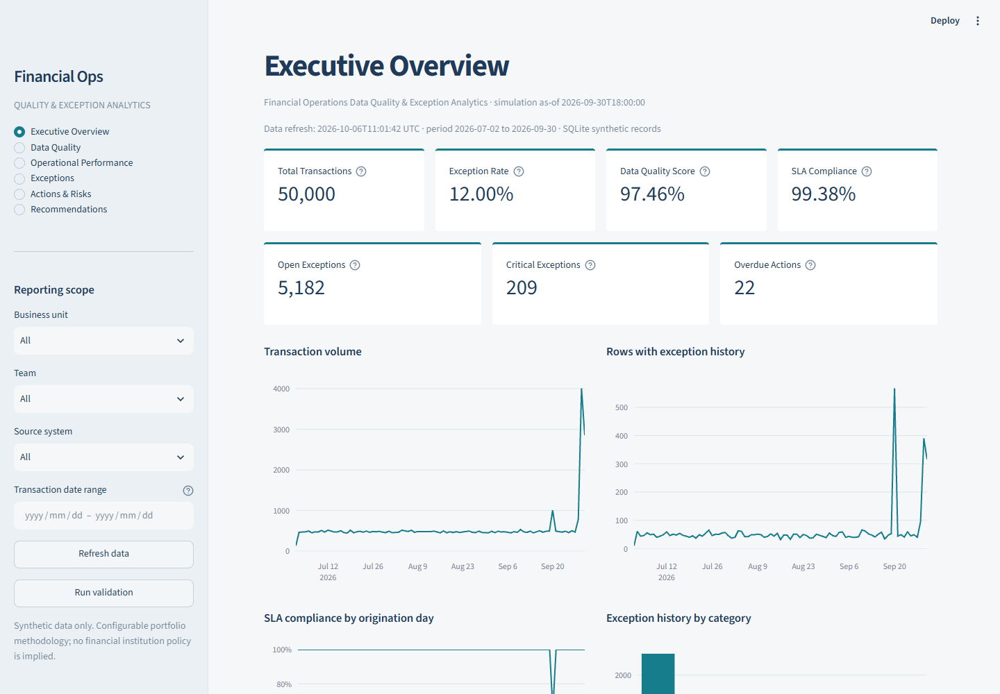

# Financial Operations Data Quality & Exception Analytics

A complete local portfolio application turning synthetic operational records into validated data, prioritized exceptions, operational KPIs, owned remediation, and management reports.

**[Live executive report demo](https://prajuval69.github.io/financial-operations-exception-analytics/)** · [Public source repository](https://github.com/Prajuval69/financial-operations-exception-analytics)

The live site is a read-only synthetic-data report with interactive charts and an Excel download. The complete Streamlit/FastAPI application, including editable workflows, runs locally using the instructions below. GitHub Pages serves `docs/index.html`; it does not run the Python backend.

**All data is synthetic.** SLA, thresholds, quality weights and risk scales are project methodology, not institutional production policies. No API keys, paid services, proprietary datasets, Power BI Desktop, or runtime internet connection are required.

```text
Synthetic generator / CSV → SQLite ingestion → 27 validation controls
  → classified and prioritized exceptions → 22 KPIs and operational trends
  → actions, dependencies, risks and audit history → FastAPI + Streamlit
  → ten-sheet Excel workbook + offline executive HTML
```

The default demo contains 50,000 transactions, 5,000 accounts, 10 business units, 8 teams, 6 sources, 12% intentionally defective rows, simulated historical exception resolutions, 80 actions and 30 risks.



## Quick start

Requires Python 3.11+ and uv. Run from the repository root:

```bash
uv sync --frozen --extra dev
uv run --frozen --extra dev python -m app.cli demo
```

In separate terminals:

```bash
uv run --frozen --extra dev uvicorn app.main:app --host 127.0.0.1 --port 8000
uv run --frozen --extra dev streamlit run dashboard/app.py
```

Open [dashboard](http://127.0.0.1:8501), [API docs](http://127.0.0.1:8000/docs), or [health](http://127.0.0.1:8000/health). The dashboard uses shared services directly and runs independently of the API.

### Standard pip setup

```bash
python -m venv .venv
```

Activate with PowerShell `.venv\Scripts\Activate.ps1`, Command Prompt `.venv\Scripts\activate.bat`, or Linux/macOS `source .venv/bin/activate`.

```bash
python -m pip install -r requirements-dev.txt
python -m pip install --no-deps -e .
python -m app.cli demo
uvicorn app.main:app --host 127.0.0.1 --port 8000
# separate activated terminal
streamlit run dashboard/app.py
```

The lockfile and exported requirements pin the verified dependencies with Python/platform markers. Installation needs network access; application use and generated reports work offline. A virtual environment avoids conflicts with unrelated applications.

## Common operations

After activating the environment:

```bash
python -m app.cli init-db
python -m app.cli seed --rows 50000 --accounts 5000 --seed 42
python -m app.cli validate
python -m app.cli kpis
python -m app.cli report all
python -m app.cli dictionary
python -m app.cli --help
```

`demo` combines generation, validation, simulated remediation history and reports. `seed` omits remediation history. Both require an empty dataset. `python -m app.cli reset-db --yes` explicitly deletes all database records, including audit history, and recreates the schema. Generated reports remain available.

CSV round-trip into an empty database:

```bash
python -m app.cli ingest data/raw/transactions.csv --accounts data/raw/accounts.csv --as-of 2026-09-30T18:00:00 --synthetic
python -m app.cli validate
```

A compact checked-in example lives in `data/demo/`. `--synthetic` acknowledges the synthetic-only input requirement. Ingestion retains defective values; dataset replacement never silently discards remediation.

## Dashboard and reporting

Six views: Executive Overview, Data Quality, Operational Performance, Exceptions, Actions & Risks, Recommendations. Global business-unit/team/source/date filters scope shared calculations and linked workflow records. Unlinked global actions/risks appear only in the unfiltered portfolio. Empty denominators show **N/A**.

Views include source/refresh/period context, definitions, trends, source/unit quality, rule failures, TAT distribution, team SLA, simulated stage durations, exception aging, CSV downloads, workflow forms and scoped report downloads.

Reports appear in `reports/`. Excel includes all scoped exceptions/actions/risks, a 1,000-row transaction sample, synchronized dictionary, formulas and policy. Executive HTML includes offline charts, all 22 KPIs, traceable suggestions, methodology and limitations. Open it in a browser; print to PDF if desired. Checked-in examples live in `reports/examples/`. API report POSTs return files, with server-generated names and atomic writes.

## Configuration and interpretation

Edit `config/policy.json` for SLA, outlier threshold, disabled rules, severity overrides, quality weights, aging boundaries and priority/risk cutoffs.

| Optional variable | Default |
|---|---|
| `FINOPS_DATABASE_URL` | `sqlite:///data/finops.db` |
| `FINOPS_CONFIG` | `config/policy.json` |
| `FINOPS_OUTPUT_DIR` | `reports` |

PowerShell example: `$env:FINOPS_DATABASE_URL = 'sqlite:///data/another-demo.db'`. Linux/macOS: `export FINOPS_DATABASE_URL=sqlite:///data/another-demo.db`.

Fixed simulation as-of: **2026-09-30 18:00 UTC**. It drives aging, SLA, overdue actions and lifecycle timestamps. Ingestion/audit/report generation record actual UTC time. `validate --as-of ...` updates simulation time. Identical generation inputs reproduce records/defects; report names and refresh timestamps vary.

Amounts retain currency codes and are never summed across currencies. TAT/SLA exclude invalid, missing and negative completion durations and disclose the excluded Completed count. Exception rate includes resolved history; current quality recomputes enabled rules. Backlog trend is current backlog by origination day, not historical stock. Invalid dates remain in unfiltered totals but are excluded from temporal plots and date-filtered views. Root-cause labels are rule-derived hypotheses; recommendations are analytical suggestions.

## Verification

```bash
uv run --frozen --extra dev pytest --cov=app --cov=dashboard --cov-report=term-missing
uv run --frozen --extra dev ruff check .
uv run --frozen --extra dev ruff format --check .
uv run --frozen --extra dev python scripts/benchmark.py --rows 100000
```

Coverage includes every rule/KPI, injected defects, determinism, database operations, workflows, API filters/errors/pagination, report generation, CLI and all six dashboard views with seeded/empty data. See [actual validation evidence](docs/FINAL_VALIDATION.md), [benchmark](docs/benchmark.json) and [traceability](docs/REQUIREMENTS_TRACEABILITY.md). GitHub Actions defines Windows/Linux Python 3.11/3.12 gates; hosted execution is separate from local verification.

## Docker

```bash
docker compose up --build
```

An idempotent seed service initializes an empty database. API/dashboard share named data/report volumes and localhost ports 8000/8501. `docker compose down` preserves data; `docker compose down -v` deliberately deletes the volumes. See [deployment](DEPLOYMENT.md) for troubleshooting and verification limits.

## Code and documentation

| Location | Responsibility |
|---|---|
| `app/core`, `app/db` | Policy, structured logs, schema/upgrades, sessions |
| `app/domain` | Rules, priority, timestamps and KPI formulas |
| `app/services` | Generation, ingestion, validation, analytics, audited workflows |
| `app/main.py`, `app/api` | API routes and validated schemas |
| `dashboard` | Streamlit presentation/forms |
| `app/reports` | Excel and executive HTML |
| `tests`, `scripts` | Verification, benchmark and container helpers |
| `docs` | Traceability, methods, validation evidence and screenshots |

See [architecture](ARCHITECTURE.md), [dictionary](DATA_DICTIONARY.md), [API](API_SPEC.md), [methodology](docs/METHODOLOGY.md), and [demo](DEMO_SCRIPT.md).

This trusted local application has no authentication, live feeds, FX conversion, institutional security approval, or production settlement engine. It demonstrates control detection and operational analytics without processing real financial transactions. MIT licensed.
